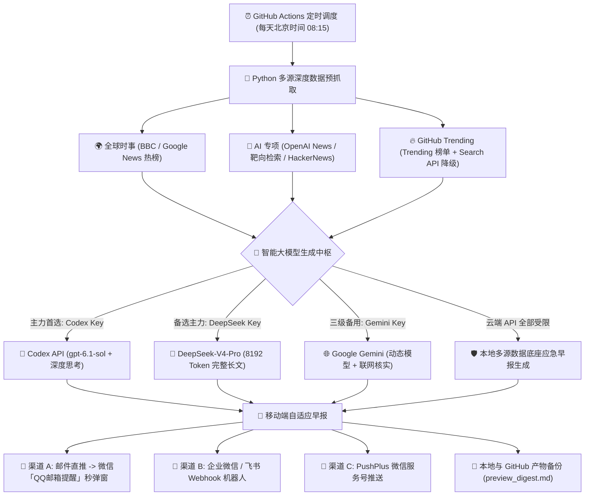

# 🌅 每日 AI & 全球资讯早报 (Daily AI & Global Digest)

> 基于 **GitHub Actions + 多层大模型智能引擎 (Codex gpt-6.1-sol / DeepSeek-V4-Pro / Google Gemini) + 多渠道免费推送** 构建的每日自动化深度早报系统。每天北京时间早上准时将高质量、排版优美的全球要闻、指定 AI 巨头动态及 GitHub 热门项目推送到你的微信或邮箱。

---

## 🌟 核心特色板块

1. **🌍 板块一：全球时事（重深度、脉络与多方影响）**
   - 聚焦过去 24 小时最关键的 4~6 条国际政经/科技/地缘热点。
   - 梳理清晰的**前因后果与背景脉络**，揭示深层经济博弈与地缘逻辑。
   - 分析各方态度与对全球产业链/普通人的长远影响，并附带**权威媒体来源链接**。
2. **🤖 板块二：指定 AI 核心生态追踪（巨头聚焦 + 福利羊毛专栏）**
   - 重点锁定三大巨头：**OpenAI (GPT / Codex)**、**Google (Gemini / AI Studio / Antigravity)**、**Anthropic (Claude / Claude Code)**。
   - 解析重磅版本升级、核心 API/功能更新及实用技巧。
   - **特别设立【今日福利与优惠活动】专栏**：严谨检索是否有最新的免费额度发放、学生优惠、API 赠金、限免或平替渠道；若无新增活动则明确如实标注，绝不凭空捏造。
3. **🔥 板块三：GitHub 热门开源项目（通俗大白话场景化解读）**
   - 精选 5~6 个今日 Trending 榜单及近期爆发式高星开源项目（优先 AI 应用与数码/生产力工具）。
   - **大白话解读**：“这项目到底是干啥的？”、“它解决了什么痛点 / 有什么好玩的？”用生活化比喻和场景解读，坚决杜绝生硬技术黑话堆砌。
   - 附带仓库链接、主要语言以及今日新增 Stars 与总 Stars。

---

## 🧠 支持的大模型引擎（智能防呆与四级自动容灾）

系统原生支持顶级大模型调度矩阵，支持自由切换主力引擎，并具备四级平滑自动降级能力：

| 大模型引擎 | 特性与优势 | 配置方式 | 推荐指数 |
| :--- | :--- | :--- | :--- |
| **Codex API (`gpt-6.1-sol` + `medium` 思考)** | 旗舰级逻辑推演与深度长文本综合能力，内置双节点自动故障转移 (`ca.memofun.net` / `codex-api.aizex.net`) | 配置 `CODEX_API_KEY`（可选设 `PRIMARY_ENGINE=codex`） | ⭐⭐⭐⭐⭐ **(主力首选)** |
| **DeepSeek 官方 API (`deepseek-v4-pro`)** | 国内直连极稳、深度逻辑提炼卓越、绝无封号风控、8192 Token 完整长文输出 | 配置 `DEEPSEEK_API_KEY`（可选设 `PRIMARY_ENGINE=deepseek`） | ⭐⭐⭐⭐⭐ **(备用/可选首选)** |
| **Google Gemini API (联网 Grounding)** | 自动动态探测可用模型（Gemini 4 / 3.8 / 2.5 Flash），支持 Google Search 联网核实 | 配置 `GEMINI_API_KEY`（在 Google AI Studio 免费申请） | ⭐⭐⭐⭐ |
| **本地多源数据底座应急引擎** | 当所有云端 API 遭遇网络或权限风控时自动触发，基于本地预抓取的 49+ 条丰富数据编排早报 | 无需配置，全自动兜底，保证微信早报 100% 准时送达 | 🛡️ **(自动兜底)** |

---

## 📨 支持的推送渠道（支持多通道共存）

系统已内置多通道支持，配置了哪个就推哪个，支持同时推送到多个渠道：

| 推送渠道 | 费用与认证 | 推送体验 | 推荐指数 | 适用场景 |
| :--- | :--- | :--- | :--- | :--- |
| **渠道 A：邮件直推 + 微信「QQ邮箱提醒」** | **100% 免费，免实名认证** | 微信官方插件秒级弹窗，点开是自适应精美卡片 | ⭐⭐⭐⭐⭐ **(强烈推荐)** | 个人微信无门槛接收 |
| **渠道 B：企业微信 / 飞书群机器人** | **100% 免费，免实名认证** | 群内 Markdown 互动卡片通知 | ⭐⭐⭐⭐⭐ | 团队/办公群或自建工作台 |
| **渠道 C：PushPlus 推送加** | 新用户需 3.9 元微信实名认证费 | 微信服务号图文通知 | ⭐⭐⭐ | 已完成认证的 PushPlus 老用户 |

> 💡 **为什么首推【渠道 A：QQ邮箱直推 + 微信QQ邮箱提醒】？**  
> 1. **零成本**：无需向任何第三方推送平台支付实名认证服务费。  
> 2. **原生稳定**：利用腾讯官方微信内置的「QQ邮箱提醒」插件，收到早报邮件时微信像接收微信消息一样秒级弹出提醒卡片。  
> 3. **体验极佳**：邮件内置定制的移动端响应式渐变 HTML 模板，排版精致美观，阅读体验远超普通纯文本。

---

## 🏗️ 系统架构与工作流程



---

## 🚀 快速上手与本地测试

### 1. 准备环境
克隆本项目后，进入项目目录并建议使用虚拟环境（以 D 盘为例）：
```bash
cd d:\Codex\Gemini\daily-ai-digest
python -m venv .venv
# Windows 激活
.venv\Scripts\activate
# 安装依赖
pip install -r requirements.txt
```

### 2. 配置环境变量
复制 `.env.example` 为 `.env`：
```bash
copy .env.example .env
```
用编辑器打开 `.env` 并填写相关凭据：

```ini
# ==================== 大模型 API 配置（按优先级智能调度） ====================
# 【主力引擎首选】Codex API（内置双节点自动容灾：ca.memofun.net -> codex-api.aizex.net）
PRIMARY_ENGINE=codex
CODEX_API_KEY=your_codex_api_key_here
CODEX_MODEL=gpt-6.1-sol
CODEX_EFFORT=medium

# 【第二梯队引擎】DeepSeek 官方 API（国内直连极稳，8192 Token 完整长文输出）
DEEPSEEK_API_KEY=sk-your_deepseek_key_here
DEEPSEEK_MODEL=deepseek-v4-pro

# 【第三梯队备用】Google Gemini API（https://aistudio.google.com/）
GEMINI_API_KEY=

# ==================== 0元免实名推送方案（强烈推荐） ====================
# 【渠道 A】邮件直推 + 微信「QQ邮箱提醒」实时弹窗
EMAIL_SENDER=123456@qq.com
EMAIL_PASSWORD=你的邮箱SMTP专属授权码
EMAIL_RECEIVER=123456@qq.com

# 【渠道 B：选填】企业微信 / 飞书群机器人 Webhook
WEBHOOK_URL=

# 【渠道 C：选填】PushPlus Token
PUSHPLUS_TOKEN=
```

> 🔑 **QQ 邮箱 SMTP 授权码获取指引（1分钟搞定）：**  
> 1. 电脑浏览器登录 [QQ邮箱网页版](https://mail.qq.com/)。  
> 2. 点击左上角 **设置** -> **账户**。  
> 3. 向下滚动到 **POP3/IMAP/SMTP/Exchange/CardDAV/CalDAV服务**。  
> 4. 开启 **POP3/SMTP服务**，按页面指引发送短信后即可得到 16 位**授权码**，填入 `EMAIL_PASSWORD` 即可！  
> 5. **微信开启弹窗**：手机微信搜索打开「QQ邮箱提醒」功能插件，绑定你的 QQ 邮箱并开启接收提醒。

### 3. 本地运行测试
```bash
python main.py
```
运行完成后，你配置的邮箱/微信将收到早报，同时项目根目录会生成 `preview_digest.md` 供离线预览。

---

## ⚙️ 部署到 GitHub Actions（全自动云端托管）

无需拥有云服务器，直接利用 GitHub 官方免费的 Actions 算力即可全天候自动运行！

### 步骤一：创建 GitHub 仓库并上传代码
将本项目提交并推送到你的 GitHub 私有或公开仓库中：
```bash
git init
git add .
git commit -m "feat: initial daily ai digest system"
git branch -M main
git remote add origin <你的GitHub仓库地址>
git push -u origin main
```

### 步骤二：配置 GitHub Secrets（密钥安全存储）
1. 打开你的 GitHub 仓库页面，点击右上角的 **Settings**。
2. 在左侧菜单中展开 **Secrets and variables** -> 点击 **Actions**。
3. 点击 **New repository secret** 按钮，根据你使用的渠道添加 Secret：

| Secret 变量名 | 是否必填 | 说明 |
| :--- | :--- | :--- |
| **`PRIMARY_ENGINE`** | 选填 | 优先引擎选择（`codex` 或 `deepseek`，默认 `codex`） |
| **`CODEX_API_KEY`** | **强烈推荐 (主力引擎)** | Codex API 密钥，调用 `gpt-6.1-sol` + `medium` 思考 |
| **`CODEX_MODEL`** | 选填 | 默认 `gpt-6.1-sol` |
| **`CODEX_EFFORT`** | 选填 | 思考深度，默认 `medium`（支持 `low`/`medium`/`high`/`xhigh`） |
| **`DEEPSEEK_API_KEY`** | **强烈推荐 (备用主力)** | DeepSeek 官方 API Key（`sk-...`），极稳长文推荐 |
| **`DEEPSEEK_MODEL`** | 选填 | 默认 `deepseek-v4-pro` |
| **`GEMINI_API_KEY`** | 可选 (第三梯队) | Google AI Studio 申请的 API Key |
| **`EMAIL_SENDER`** | 推荐 (推送渠道A) | 发件邮箱（如 `xxx@qq.com`） |
| **`EMAIL_PASSWORD`** | 推荐 (推送渠道A) | 邮箱 SMTP 专属授权码（非登录密码） |
| **`EMAIL_RECEIVER`** | 选填 (推送渠道A) | 收件邮箱（留空默认发给发件人自己） |
| **`WEBHOOK_URL`** | 可选 (推送渠道B) | 企业微信或飞书机器人的 Webhook 完整地址 |
| **`PUSHPLUS_TOKEN`** | 可选 (推送渠道C) | PushPlus Token |

### 步骤三：立即手动测试
1. 在仓库页面点击上方的 **Actions** 标签栏。
2. 在左侧选择 **Daily AI & Global Digest** 工作流。
3. 点击右侧的 **Run workflow** 按钮（支持直接在下拉菜单中切换 `codex` / `deepseek` 引擎测试）。
4. 点击正在运行的任务查看实时日志，稍等 1~2 分钟，微信/邮箱即可收到今日早报！

---

## ⏰ 定时任务说明与时间调整

GitHub Actions 配置文件位于 `.github/workflows/daily_digest.yml`：
```yaml
schedule:
  - cron: '15 1 * * *'  # UTC 01:15 = 北京时间 09:15
```
> **为什么设为 09:15？**  
> GitHub Actions 定时任务在整点（如 00/30 分）高峰期排队较多，通常会有 5~15 分钟的排队延迟。设置在 UTC 01:15 (北京时间 09:15) 触发调度，脚本执行通常耗时 1~2 分钟，刚好能在 **09:20 ~ 09:30** 之间稳妥送达手机。  
> 若你想修改推送时间，可按 UTC 时间换算（UTC = 北京时间 - 8 小时）。

---

## 🛡️ 容错与兜底机制说明

- **多源数据深度抓取**：单个 RSS 源或网络超时绝不阻断整体流程，摘要提取放宽至 500 字符保留丰富上下文。
- **大模型智能四级容灾调度矩阵**：
  1. **主力第一梯队 (Codex API)**：默认调用 `gpt-6.1-sol`，思考深度设为 `medium`，内置 `ca.memofun.net` 与 `codex-api.aizex.net` 双节点自动热备重试，超时设为 150 秒。
  2. **备用第二梯队 (DeepSeek API)**：当 Codex 未配置或两节点均异常时，无缝降级至官方 `deepseek-v4-pro`，最大 Token 开放至 8192，保证长文结构完整无截断。亦可通过 `PRIMARY_ENGINE=deepseek` 直接将 DeepSeek 设为主力。
  3. **三级备用 (Google Gemini API)**：支持动态探测并调用最新 Gemini 闪电模型与 Google Search 联网核实。
  4. **全自动本地应急引擎**：若所有云端 API 遭遇网络或权限风控，自动激活本地多源数据底座应急早报生成引擎，确保每日微信/邮件 100% 准时推送，绝不空手。
- **多推送渠道独立容错**：邮件、企业微信/飞书 Webhook、PushPlus 独立执行，互不影响。
- **本地降级与备份**：未配置任何推送渠道时，早报自动留存于本地 `preview_digest.md`，并在 Actions 中自动上传为构建产物（Artifact）。

---

## 📄 开源许可证
本项目遵循 MIT License 许可证。
