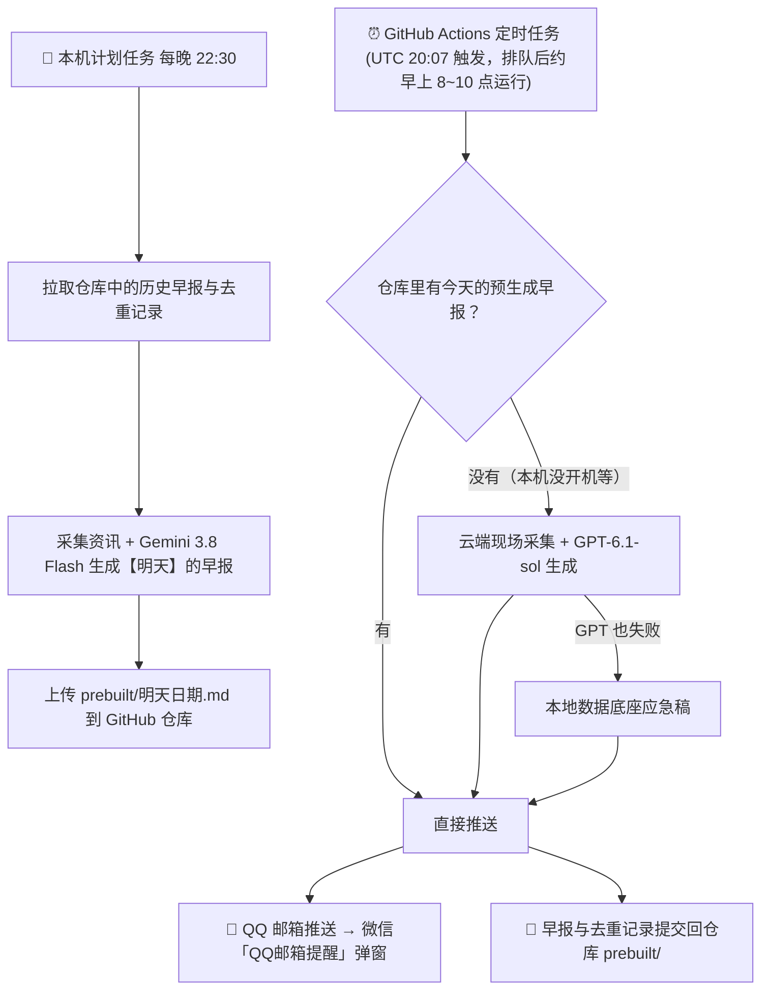

# 🌅 每日 AI & 全球资讯早报 (Daily AI & Global Digest)

> 基于 **本机夜间预生成（Gemini 3.8 Flash）+ GitHub Actions 云端兜底（GPT-6.1-sol）+ QQ 邮箱推送** 的每日自动化早报系统。每天早上把全球要闻、AI 御三家与科技四巨头动态、GitHub 热门项目推送到你的邮箱 / 微信「QQ邮箱提醒」。

---

## 🌟 早报内容

1. **🌍 板块一：全球时事**
   - 过去 24 小时最关键的 4~5 条国际政经 / 科技 / 地缘热点，讲清前因后果、各方态度与影响，并附来源链接。
2. **🤖 板块二：AI 核心御三家 & 科技四巨头**
   - **🧠 AI 御三家**：OpenAI (GPT / Codex)、Google (Gemini / Antigravity)、Anthropic (Claude)。
   - **⚡ 科技四巨头**：
     - **英伟达 NVIDIA**：AI 芯片、CUDA 生态、黄仁勋动向
     - **特斯拉 Tesla**：FSD、Optimus 机器人、Robotaxi
     - **华为 Huawei**：新品与发布会、麒麟芯片、手机 / 电脑 / 平板 / 耳机 / 手表、鸿蒙系统
     - **苹果 Apple**：新品与发布会、A/M 系列芯片、iPhone / Mac / iPad / AirPods / Watch、iOS / macOS 与 Apple Intelligence
   - 某家当天没有实质新闻时宁缺毋滥，不凑数。
3. **🔥 板块三：GitHub 开源项目寻宝**
   - **📈 今日飙升热榜**：每天精选 **3 个** GitHub Trending 项目。
   - **💎 每日宝藏推荐**：每天 **2 个** 经典高星项目（32 个领域按日期轮换 + 22 个本地精选兜底）。
   - 面向**不懂编程的读者**撰写，每个项目固定包含：📌 一句话说清 / 💡 打个比方 / 🎬 能怎么用 / 🚪 上手门槛 / ⚠️ 要注意 / 🙋 对我有用吗（宝藏项目额外有 🆚 和谁比）。
   - 每个候选项目都会**实时拉取 GitHub 最新资料**（README、最新版本与安装包平台、最后更新时间、是否测试版），模型只能依据这些资料写，测试版、停更、新项目必须如实标注。
   - 「🙋 对我有用吗」依据 `reader_profile.md`（个人硬件与已部署的相册、影视库等方案）判断。该文件不提交到公开仓库，云端使用 Secret `READER_PROFILE`，修改后需重新同步该 Secret。
   - **30 天内不重复推荐**同一个项目。

---

## 🏗️ 工作流程



**为什么分两段？** 本机的 Gemini 3.8 Flash 走本地 Antigravity 网关（`127.0.0.1:8317`），只有电脑开着才能用；所以每晚提前写好第二天的稿子放到仓库，早上由云端负责发送。电脑没开机时，云端会自己用 GPT-6.1-sol 写。

---

## 🧠 大模型引擎

| 顺序 | 引擎 | 运行位置 | 所需配置 |
| :--- | :--- | :--- | :--- |
| 1 | **Gemini 3.8 Flash**（本地 Antigravity 网关） | 仅本机（夜间预生成） | `LOCAL_LLM_API_KEY`，可选 `LOCAL_LLM_BASE_URL`、`LOCAL_LLM_MODEL` |
| 2 | **GPT-6.1-sol (High)**（`/v1/responses` 协议） | 本机备用 / 云端主力 | `CODEX_API_KEY` 或 `AIZEX_API_KEY`（两个 Key 可互为备份） |
| 3 | **本地数据底座应急稿** | 任意 | 无需配置，所有模型都失败时自动启用 |

GPT 节点自动在 `ca.memofun.net` 与 `codex-api.aizex.net` 之间轮换（云端优先后者），最多重试 3 次，第 3 次自动改为非流式请求。也可用 `CODEX_BASE_URL` / `AIZEX_BASE_URL` 指定自定义节点。

> 预生成模式下若模型全部失败，不会把应急稿落盘，云端第二天会自己重新生成。

---

## 🛡️ 去重机制

- 每天的早报会记录到 `prebuilt/history_seen.json`（保留 30 天），并同步到 GitHub 仓库，本机和云端共用同一份记录。
- **GitHub 项目**：30 天内推荐过的一律跳过，且完整名单会写进提示词让模型避开。
- **新闻**：7 天内出现过的链接和高度相似的标题会被过滤（有重大新进展除外）。

---

## 🚀 本地运行

### 1. 准备环境
```powershell
cd D:\Codex\Gemini\AI早报
python -m venv .venv
.venv\Scripts\activate
pip install -r requirements.txt
```

### 2. 配置 `.env`
```powershell
copy .env.example .env
```
按 `.env.example` 中的注释填写模型 Key 与邮箱信息。

### 3. 运行方式

| 命令 | 作用 |
| :--- | :--- |
| `python main.py` | 立即生成并推送今天的早报 |
| `run_prebuild.ps1` | 预生成**明天**的早报并上传仓库（计划任务调用的就是它，经 `run_prebuild_silent.vbs` 静默启动） |
| `python push_prebuilt.py` | 上传最近 3 份预生成早报与去重记录 |
| `python push_prebuilt.py --pull` | 从仓库拉取云端生成的早报与去重记录 |
| `python push_prebuilt.py --code` | 额外把 `main.py`、工作流、`push_prebuilt.py` 同步到仓库 |

运行日志见 `prebuild.log`，最新一份早报见 `preview_digest.md`。

> `push_prebuilt.py` 依次从环境变量 `GITHUB_TOKEN`、`.env`、`.gh_token.json` 读取 GitHub Token。

---

## ⚙️ GitHub Actions 配置

仓库：`zjh-fyy/daily-ai-digest`（公开仓库，避免私有仓库定时任务长时间排队）。

在仓库 **Settings → Secrets and variables → Actions** 中添加：

| Secret | 是否必填 | 说明 |
| :--- | :--- | :--- |
| `CODEX_API_KEY` | 必填（与下一项至少一个） | GPT-6.1-sol 的 API Key |
| `AIZEX_API_KEY` | 选填 | 备用 Key |
| `CODEX_BASE_URL` / `AIZEX_BASE_URL` | 选填 | 自定义 API 节点 |
| `CODEX_MODEL` / `CODEX_EFFORT` | 选填 | 默认 `gpt-6.1-sol` / `high` |
| `EMAIL_SENDER` | 必填 | 发件邮箱，如 `xxx@qq.com` |
| `EMAIL_PASSWORD` | 必填 | 邮箱 SMTP 授权码（不是登录密码） |
| `EMAIL_RECEIVER` | 选填 | 收件邮箱，留空发给自己 |
| `SMTP_SERVER` | 选填 | 如 `smtp.qq.com:465`，默认按邮箱后缀自动识别 |
| `READER_PROFILE` | 选填 | `reader_profile.md` 的全文，用于个性化分析 GitHub 项目 |

**定时说明**：`.github/workflows/daily_digest.yml` 中 `cron: '7 20 * * *'`（UTC 20:07 = 北京时间 04:07）。GitHub 免费定时任务经常排队数小时，提前触发是为了让早报在早上送达。工作流需要 `contents: write` 权限，用于把当天早报提交回仓库。

手动测试：仓库 **Actions → Daily AI & Global Digest → Run workflow**。

---

## 📧 QQ 邮箱 + 微信提醒设置

1. 登录 [QQ 邮箱网页版](https://mail.qq.com/) → **设置 → 账户**。
2. 开启 **POP3/SMTP 服务**，按提示发短信获得 16 位**授权码**，填入 `EMAIL_PASSWORD`。
3. 手机微信搜索「QQ邮箱提醒」，绑定邮箱并开启提醒，收到早报时微信会弹出通知。

---

## 📄 开源许可证
本项目遵循 MIT License。
